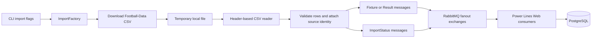

[](https://github.com/johnwatson484/power-lines-data-service/actions/workflows/build.yaml)

# Power Lines Data Service

A .NET 10 command-line importer for football fixtures, results and bookmaker prices from Football-Data CSV files. It publishes records to RabbitMQ for [Power Lines Web](https://github.com/johnwatson484/power-lines-web), which stores the data in PostgreSQL and generates forecasts. This repo owns ingestion; the forecasting models live in the web repo.

## How it works



1. `Program.cs` builds the .NET host, reads the `Message` configuration and opens a broker connection.
2. `ImportService` selects results and/or fixtures from the command-line flags. If both are requested, results run first.
3. `ImportFactory` supplies the source URLs, temporary files and readers:
   - Fixtures: `https://www.football-data.co.uk/fixtures.csv`.
   - Results: `https://www.football-data.co.uk/mmz4281/{season}/{division}.csv`.
4. Readers use column names, support historical header variants, validate identities and scores, and attach hashes and price provenance. Invalid rows are skipped with row diagnostics on stderr. Missing prices become `0`; missing half-time scores remain null.
5. Records are published individually to the configured fixture/result fanout exchange. Completion messages are sent through the fixed `imports` exchange (sender names use the configured record exchange plus `-imports`). Start the web consumers before importing so their subscription queues exist.
6. Temporary CSV files are deleted after each source. The broker connection closes when the run finishes. There is no HTTP server, database or import scheduler in this repo.

Results cover 22 division codes: `E0`, `E1`, `E2`, `E3`, `EC`, `SC0`, `SC1`, `SC2`, `SC3`, `D1`, `D2`, `I1`, `I2`, `SP1`, `SP2`, `F1`, `F2`, `N1`, `B1`, `P1`, `T1`, `G1`.

For result imports, download failures/timeouts are counted as unavailable sources and skipped. Parsing or publishing failures are recorded, remaining sources are attempted, and the job fails at the end if any source failed. The summary reports imported, unavailable and failed sources. Fixture import failures fail the run immediately.

## Message models

The contracts are in [PowerLinesDataService/Models](PowerLinesDataService/Models). They are sent through the `PowerLinesMessaging` package and consumed by the web repo.

| Model | Contents |
| --- | --- |
| `Fixture : SourceRecord` | Division, kickoff date/time, home/away teams and average decimal home/draw/away prices. Source times have no timezone offset. |
| `Result : SourceRecord` | Match identity, full-time goals and `H`/`D`/`A` outcome, optional half-time goals/outcome, and average decimal prices. Result dates are read without kickoff times. |
| `SourceRecord` | Source URL/season, SHA-256 file hash, row/match identities, price kind, collection description, optional quote observation time and `SourcePrices`. |
| `SourcePrice` | Original column prefix, price kind and a complete home/draw/away price triplet. Average, maximum and individual bookmaker columns are retained separately, including closing variants. |
| `ImportStatus` | Source URL, division, season, file hash, published row count, UTC completion time and `Status = Completed`; `RecordType` defaults to `ImportStatus`. |

Primary average prices come from `Avg` or legacy `BbAv` columns. Closing, maximum and bookmaker prices remain separate source observations. The CSV reader does not establish when a quote was observed, so `QuoteObservedAt` remains null and these prices do not establish an available betting offer.

Fixture match identity hashes season, division and the home/away pairing to support rescheduling. Result identity also includes the played date to distinguish repeated pairings within a season. Ambiguous duplicates within a source fail before publication.

## Dependencies

- .NET 10 SDK (selected by `global.json`).
- Docker Engine/Desktop and Compose 2.24+ for RabbitMQ and Testcontainers integration tests.
- Bash for scripts and VS Code tasks (use WSL on Windows), and the C# extension for native debugging.
- Registry/NuGet access for builds; outbound HTTPS to Football-Data for real imports.
- A writable OS temporary directory. This app has no database or HTTP listener.

## Run natively

```sh
cp .env.example .env
dotnet restore
./scripts/local --results
./scripts/run-service --fixtures
```

`local` starts RabbitMQ and waits for health, then runs the requested import on the host. `run-service` runs once against the configured broker and forwards all import flags. It does not start dependencies in native mode; use `services-up` or `local` first. Direct .NET execution works too:

```sh
./scripts/services-up
dotnet run --project PowerLinesDataService -- --fixtures
```

RabbitMQ listens at `localhost:5672`, with management UI `http://localhost:15672` and example credentials `rabbitmq` / `rabbitmq`. VS Code provides separate import, dependency, build, test and watch tasks. **Dev: native** debugs a fixture import after dependencies are started.

### Run an import in Docker

```sh
./scripts/run-service --docker --results
./scripts/run-service --docker --fixtures
```

Docker mode starts/waits for RabbitMQ, builds the development app and uses a disposable `docker compose --profile app run --rm --no-deps` container. The importer is a one-shot command, with no idle service, automatic startup import or scheduler. Plain `docker compose up -d` starts only the broker.

### Shared RabbitMQ and standalone use

Each app repo defines the same `power-lines-message` service in Compose project `power-lines`, on network `power-lines`. Either repo can start independently; starting the other sequentially reuses the broker. Keep `Message__Username`, `Message__Password`, `Message__Port` and `RABBITMQ_MANAGEMENT_PORT` identical in both `.env` files. Container apps use the broker's internal hostname and port automatically. The `fixtures`, `results` and `imports` fanout exchanges are unchanged.

Use [Power Lines Core](https://github.com/johnwatson484/power-lines-core) for sibling clones and the VS Code workspace. Core calls each repo's startup commands sequentially and owns no dependencies. Start web and wait for its “Consuming fixtures, results and import statuses” log before importing, so subscription queues exist. Import results before fixtures when building forecasting history.

`./scripts/services-down` stops this repo's dependency containers, including shared RabbitMQ, and affects both apps. It retains containers, the shared network and stored data. Stop native apps with Ctrl+C or terminate their VS Code tasks. Do not use `--remove-orphans`: the other repo's services belong to the same project. Web's `power-lines_postgres_data` volume is retained; remove it only when deliberately resetting development data.

### Run both repos together

With sibling clones, start web first:

```sh
cd ../power-lines-web
cp -n .env.example .env
./scripts/local
# In another terminal after web consumers are ready:
cd ../power-lines-data-service
cp -n .env.example .env
./scripts/local --results --all
./scripts/run-service --fixtures
```

Core's workspace offers this native web process alongside a ready importer terminal and explicit import tasks.

### Import flags

| Flag | Behavior |
| --- | --- |
| `--fixtures` | Import the current fixtures file. |
| `--results` | Import the current results season across all configured divisions. |
| `--all` | With `--results`, import seasons starting at 1993/94 through the current season. Has no effect on fixtures. |

Flags can be combined, for example `./scripts/run-service --results --all --fixtures`. With neither `--results` nor `--fixtures`, the app still opens/closes the broker connection but imports nothing. Current-season selection uses the host's local date: January–May selects the season starting the previous year; June–December selects the season starting that year, with a special case for the extended 2019/20 season.

### Production image

```sh
docker build --target production -t power-lines-data-service .
docker run --rm --env-file /path/to/import.env power-lines-data-service --results
```

Provide a reachable broker in `import.env`. The production image runs the compiled DLL once as a non-root user and preserves ICU support for the importer's `en-GB` culture. Schedule recurring imports externally.

## Environment variables

Copy `.env.example` to `.env`. The app loads this optional repository-root file before building the host, from either the repo root or app project directory, without searching unrelated ancestors. Existing environment variables override file values; command-line configuration has highest precedence. Local env files are excluded from Git, Docker build contexts and published output. Deployment environments need no `.env` file.

.NET maps `__` to nested keys. The example provides:

| Variable | Native value | Purpose |
| --- | --- | --- |
| `DOTNET_ENVIRONMENT` | `Development` | Generic Host environment |
| `Message__Host` | `localhost` | RabbitMQ host; overridden to `power-lines-message` for Docker |
| `Message__Port` | `5672` | Native AMQP port; Docker always uses internal port 5672 |
| `Message__Username` / `Message__Password` | `rabbitmq` / `rabbitmq` | App and development broker credentials |
| `Message__FixtureQueue` / `Message__ResultQueue` | `fixtures` / `results` | Fanout exchanges shared with web |
| `RABBITMQ_MANAGEMENT_PORT` | `15672` | Compose management UI port |

Without configuration the message options have null/zero CLR values, so use the example file for real imports. Source URLs, divisions and the `imports` exchange remain defined in code. Compose passes `.env` through `env_file` for the app and overrides Docker hostnames. Its broker definition matches web's.

## Test and CI

```sh
dotnet test --configuration Release --collect:"XPlat Code Coverage"
# No Docker required:
dotnet test --filter 'TestCategory!=Integration'
# Real messaging package against disposable RabbitMQ:
dotnet test --filter 'TestCategory=Integration'
```

Unit tests cover historical/current CSV schemas, source identities, prices and import failures with checked-in fixtures and local HTTP sources. Integration tests use RabbitMQ Testcontainers and local CSV sources to verify record and completion-message publication through `PowerLinesMessaging`, without live Football-Data downloads. Ports are assigned dynamically; containers are cleaned up after tests. Missing Docker fails integration setup rather than skipping it. Tests do not load development `.env` files.

Projects write build outputs to repository-level `bin/` and `obj/`. PRs and the `master` publishing workflow call the same native restore/build/test workflow, which uploads TRX and coverage artifacts. Image publishing and GitHub releases remain restricted to `master`; PR checks need no publishing secrets.
