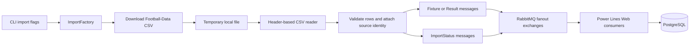

[](https://github.com/johnwatson484/power-lines-data-service/actions/workflows/build.yaml)

# Power Lines Data Service

A .NET 8 command-line importer for football fixtures, results and bookmaker prices from Football-Data CSV files. It publishes records to RabbitMQ for [Power Lines Web](https://github.com/johnwatson484/power-lines-web), which stores the data in PostgreSQL and generates forecasts. This repo owns ingestion; the forecasting models live in the web repo.

## How it works



1. `Program.cs` builds the .NET host, reads the `Message` configuration and opens a broker connection.
2. `ImportService` selects results and/or fixtures from the command-line flags. If both are requested, results run first.
3. `ImportFactory` supplies the source URLs, temporary files and readers:
   - Fixtures: `https://www.football-data.co.uk/fixtures.csv`.
   - Results: `https://www.football-data.co.uk/mmz4281/{season}/{division}.csv`.
4. Readers use column names, support historical header variants, validate identities and scores, and attach hashes and price provenance. Invalid rows are skipped with row diagnostics on stderr. Missing prices become `0`; missing half-time scores remain null.
5. Records are published individually to the configured fixture/result fanout exchange. Completion messages are sent through the fixed `imports` exchange (sender names use the configured record exchange plus `-imports`). Start the web consumers before importing so their subscription queues exist.
6. Temporary CSV files are deleted after each source. The broker connection closes when the run finishes. There is no HTTP server, database or import scheduler in this repo.

Results cover 22 division codes: `E0`, `E1`, `E2`, `E3`, `EC`, `SC0`, `SC1`, `SC2`, `SC3`, `D1`, `D2`, `I1`, `I2`, `SP1`, `SP2`, `F1`, `F2`, `N1`, `B1`, `P1`, `T1`, `G1`.

For result imports, download failures/timeouts are counted as unavailable sources and skipped. Parsing or publishing failures are recorded, remaining sources are attempted, and the job fails at the end if any source failed. The summary reports imported, unavailable and failed sources. Fixture import failures fail the run immediately.

## Message models

The contracts are in [PowerLinesDataService/Models](PowerLinesDataService/Models). They are sent through the `PowerLinesMessaging` package and consumed by the web repo.

| Model | Contents |
| --- | --- |
| `Fixture : SourceRecord` | Division, kickoff date/time, home/away teams and average decimal home/draw/away prices. Source times have no timezone offset. |
| `Result : SourceRecord` | Match identity, full-time goals and `H`/`D`/`A` outcome, optional half-time goals/outcome, and average decimal prices. Result dates are read without kickoff times. |
| `SourceRecord` | Source URL/season, SHA-256 file hash, row/match identities, price kind, collection description, optional quote observation time and `SourcePrices`. |
| `SourcePrice` | Original column prefix, price kind and a complete home/draw/away price triplet. Average, maximum and individual bookmaker columns are retained separately, including closing variants. |
| `ImportStatus` | Source URL, division, season, file hash, published row count, UTC completion time and `Status = Completed`; `RecordType` defaults to `ImportStatus`. |

Primary average prices come from `Avg` or legacy `BbAv` columns. Closing, maximum and bookmaker prices remain separate source observations. The CSV reader does not establish when a quote was observed, so `QuoteObservedAt` remains null and these prices do not establish an available betting offer.

Fixture match identity hashes season, division and the home/away pairing to support rescheduling. Result identity also includes the played date to distinguish repeated pairings within a season. Ambiguous duplicates within a source fail before publication.

## Dependencies

- Docker Engine/Desktop with Docker Compose v2 or later for the container workflow (`docker compose`).
- Alternatively, the .NET 8 SDK for local development and tests.
- RabbitMQ for imports; development Compose supplies `rabbitmq:3-management-alpine`.
- Outbound HTTPS to Football-Data and a writable OS temporary directory for source downloads.
- Network access to NuGet and Microsoft/container registries when restoring or building. NuGet dependencies are declared in the project files: .NET Hosting, Newtonsoft.Json and `PowerLinesMessaging` 3.1.0; tests use NUnit.
- The web app and its PostgreSQL database to consume and display imported records. Neither is started by this repo's Compose files.

## Run both repos together

Keep the clones in sibling directories. Let the web repo own the shared RabbitMQ service and `power-lines` Docker network, then run this importer without starting a second broker:

```sh
# In ../power-lines-web: starts the web app, PostgreSQL and RabbitMQ.
cd ../power-lines-web
docker compose up --build -d

# Back in this repo: build the development importer.
cd ../power-lines-data-service
docker compose build power-lines-data-service

# Import historical results first, then current fixtures.
docker compose run --rm --no-deps --entrypoint dotnet power-lines-data-service \
  run --project ./PowerLinesDataService -- --results --all
docker compose run --rm --no-deps --entrypoint dotnet power-lines-data-service \
  run --project ./PowerLinesDataService -- --fixtures
```

The development override connects the importer to `power-lines-message` on the shared network. Both repos use Compose project name `power-lines` and container name `power-lines-message`; use one broker owner. See the [web README](https://github.com/johnwatson484/power-lines-web#readme) for web URLs, database setup, timezone configuration and forecast availability.

## Develop this repo on its own

```sh
docker compose up --build -d
./scripts/run-service --results
./scripts/run-service --fixtures
```

Compose automatically combines `docker-compose.yaml` and `docker-compose.override.yaml`, creates the `power-lines` network, starts RabbitMQ and runs the importer under `dotnet watch`. No import flags are supplied to the watched process, so use `scripts/run-service` to launch an import inside the running development container. Source files are bind-mounted for rebuilds.

RabbitMQ is reachable from the host at `localhost:5672`; its management UI is at `http://localhost:15672`, with development credentials `rabbitmq` / `rabbitmq`. Stop the development services with `docker compose down`.

For debugging, use the Docker attach configuration in [.vscode/launch.json](.vscode/launch.json) with the VS Code C# debugger. The development image includes `/vsdbg/vsdbg`; select the importer process when prompted.

### Run locally with .NET

Start RabbitMQ first (for example, `docker compose up -d power-lines-message`), then supply all six message settings because this app has no checked-in `appsettings.json`:

```sh
export MESSAGE__HOST=localhost
export MESSAGE__PORT=5672
export MESSAGE__USERNAME=rabbitmq
export MESSAGE__PASSWORD=rabbitmq
export MESSAGE__FIXTUREQUEUE=fixtures
export MESSAGE__RESULTQUEUE=results

dotnet run --project PowerLinesDataService -- --results
dotnet run --project PowerLinesDataService -- --fixtures
```

### Import flags

| Flag | Behavior |
| --- | --- |
| `--fixtures` | Import the current fixtures file. |
| `--results` | Import the current results season across all configured divisions. |
| `--all` | With `--results`, import seasons starting at 1993/94 through the current season. Has no effect on fixtures. |

Flags can be combined, for example `./scripts/run-service --results --all --fixtures`. With neither `--results` nor `--fixtures`, the app still opens/closes the broker connection but imports nothing. Current-season selection uses the host's local date: January–May selects the season starting the previous year; June–December selects the season starting that year, with a special case for the extended 2019/20 season.

### Production image

The base Compose file builds only the production importer; it does not supply a broker or message configuration:

```sh
docker compose -f docker-compose.yaml build
docker run --rm --env-file /path/to/import.env power-lines-data-service --results
```

Create `import.env` using the six `MESSAGE__...` settings below and a broker hostname reachable from the container (`localhost` would refer to that container). The production image runs the compiled DLL once and exits. Schedule repeated imports externally if needed.

## Environment variables and defaults

The .NET configuration provider maps `__` to nested section keys and treats key casing as insignificant. Environment variables override JSON configuration if supplied; command-line configuration has higher precedence. A shell `.env` file is not loaded by the .NET app automatically. Compose's interpolation `.env` also does not inject arbitrary settings unless the Compose service declares them; use explicit `environment`/`env_file` entries or `docker run --env-file`.

| Environment variable | Default without configuration | Development Compose value | Purpose |
| --- | --- | --- | --- |
| `MESSAGE__HOST` | null/unset | `power-lines-message` | RabbitMQ hostname. Use `localhost` for a host process. |
| `MESSAGE__PORT` | `0` | `5672` | RabbitMQ AMQP port. |
| `MESSAGE__USERNAME` | null/unset | `rabbitmq` | Broker username. |
| `MESSAGE__PASSWORD` | null/unset | `rabbitmq` | Broker password. |
| `MESSAGE__FIXTUREQUEUE` | null/unset | `fixtures` | Fixture fanout exchange; match the web consumer. |
| `MESSAGE__RESULTQUEUE` | null/unset | `results` | Result fanout exchange; match the web consumer. |
| `DOTNET_ENVIRONMENT` | `Production` | Unset | Generic Host environment, used to select optional `appsettings.{Environment}.json`. |
| `ASPNETCORE_ENVIRONMENT` | Unset | Image sets `development`; production image sets `production` | Present in the Dockerfiles, but this console app uses the Generic Host's `DOTNET_ENVIRONMENT` setting. |
| `DOTNET_SYSTEM_GLOBALIZATION_INVARIANT` | Runtime/image default | SDK image default | Production image sets `false` and installs ICU for the app's `en-GB` culture. |

The null/zero message properties are unconfigured CLR values, not working connection defaults; set all six for real imports. Source URLs, the league list and the `imports` exchange are defined in code, rather than environment settings.

The RabbitMQ development container also sets `RABBITMQ_DEFAULT_USER=rabbitmq`, `RABBITMQ_DEFAULT_PASS=rabbitmq`, `RABBITMQ_DEFAULT_VHOST=/` and `RABBITMQ_ERLANG_COOKIE=rabbitmq`. These configure the broker, not the importer. Change the Compose entries and matching app credentials together when using other credentials.

## Test

```sh
dotnet test PowerLinesDataService.Tests --configuration Release
```

NUnit tests exercise current and historical CSV schemas, missing/malformed fields, price provenance, source identities, repeated pairings and import failure handling. Checked-in compressed source fixtures and test doubles make the suite independent of RabbitMQ, PostgreSQL and live source downloads. The PR workflow runs this command.

To test using the SDK container without installing .NET locally:

```sh
docker run --rm -v "$PWD:/src" -w /src mcr.microsoft.com/dotnet/sdk:8.0 \
  dotnet test PowerLinesDataService.Tests --configuration Release
```

Both projects put build outputs under the repository-level `bin/` and `obj/` directories via `Directory.Build.props`. The `master` build workflow publishes production images to Docker Hub and creates a GitHub release using the project version.
